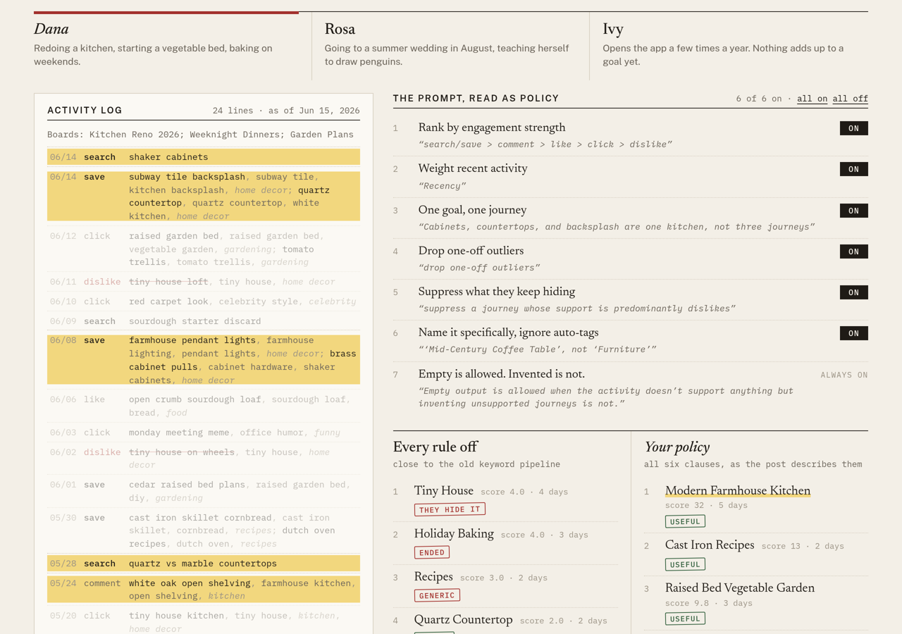

# Loose Ends

What is this person trying to finish? A bench for the written ranking policy in Pinterest's journey model.

**Live demo:** https://sheinapribadi-star.github.io/loose-ends/



## The idea in plain English

Pinterest wants to know the goal behind your activity (a kitchen remodel, a vegetable garden, an outfit for a wedding in August), not just the last thing you clicked. Its old system got there with a chain of steps: pull keywords, cluster them, name each cluster after its most common keyword. That chain split one kitchen into three journeys, named things "Art" and "Shopping", and let a couple of meme clicks take a top slot.

The new system is one model that reads the activity log and writes a short ranked list of goals. The line from the post that this project is built around: once you collapse the pipeline, *the prompt becomes the ranking policy and the safety policy.* Each sentence of the prompt is now a product decision.

Loose Ends lets you switch those sentences off one at a time, on three made-up people, and watch what happens to the four slots a notification could actually use:

- **Every rule off** behaves roughly like the old keyword pipeline: Dana's top slot is "Tiny House", a topic she keeps hiding.
- **The full policy** fills all four of Dana's slots with real, distinct, specific goals, and gives Ivy, who has no real goal in her log, an empty list, which the post counts as a correct answer.
- A **support check** shows, word by word, whether a journey name is actually backed by the log.

## Source

- Lin Zhu, Manan Kalra, Byung Eun Jeon, Ye Liu, Xiangyi Chen, Jaewon Yang, Jinwen Xu, Tingting Zhu and Sudarshan Lamkhede. [From Activity to Intent: Generating User Journeys with LLMs](https://medium.com/pinterest-engineering/from-activity-to-intent-generating-user-journeys-with-llms-9652b9417626). Pinterest Engineering, October 9, 2026.

From the post, used here: the log format (events grouped by date and action), the action order (search/save > comment > like > click > dislike), the ranking criteria (engagement strength, repeated support, recency, coherence, specificity), the rules to drop one-off outliers, treat auto-generated tags as noisy and suppress mostly-disliked journeys, the "empty is allowed, inventing is not" contract, case-insensitive dedupe, the cap of about twelve journeys, the three legacy failure modes, the evaluator's support axis, and the reported online results. Dana's first log lines adapt the example prompt printed in the post.

Loose Ends is an independent study of a public post. It is not affiliated with Pinterest and uses none of its code or data.

## What is real and what is not

- **The people and their logs are synthetic.** Dana, Rosa and Ivy are made up, and the page says so above the fold.
- **No model runs here.** In production, a fine-tuned 4B model decides which pins belong to the same goal. Here that reading step is done by hand: every pin carries a hand-written goal label and a narrower facet label. That isolates the part this project is about, the written policy.
- **The numbers are mine.** The post gives the order of actions, not weights. I use search and save 5, comment 3, like 2, click 1, and a 90-day recency half-life.

## How it works

All the logic is in [`policy.js`](policy.js) (about 150 lines, no UI). The data is in [`data.js`](data.js).

1. **Group** pins by goal, or by facet when "one goal, one journey" is off (that is how fragmentation appears).
2. **Score** each group: sum of action weights times recency decay. With the dislike rule off, a hide counts as one more keyword hit, the way the old pipeline counted it.
3. **Drop** a group if it is mostly dislikes (more hides than positive actions, no search or save) or a one-off (support on a single day).
4. **Name** it with its specific label, or, with the specificity rule off, with its most frequent keyword, auto-tags included.
5. **Rank**, dedupe names case-insensitively (first wins), cap at twelve.
6. **Grade** the top four against the synthetic truth: real goal, first time it appears, more than one word. Stamps show what went wrong: *they hide it*, *ended*, *noise*, *fragment*, *generic*.

The support check is a plain word match against positive activity with light plural handling, treating words like *making* or *beginner* as framing. It is a floor, not a judge. The post's own example output, "Modern Farmhouse Kitchen", uses "modern", which its printed sample log does not contain; that gap is exactly why the post uses a language model as the judge.

## Design decisions

The full reasoning is in [BRIEF.md](BRIEF.md). In short:

- **Show the prompt as the thing being edited.** Switched-off clauses are struck through, so the page reads like a prompt diff, and the URL carries the diff (`?p=rosa&off=dislikes,specific`) so a state can be shared in a review.
- **Score the slots that matter.** A list of twelve looks fine either way. The top four are what a notification spends, so that is what gets graded.
- **Make evidence visible.** Hovering a slot highlights its supporting lines in the log, like running a highlighter down a page.
- **A desk, not a landing page.** Newsreader for prose, IBM Plex Mono for the log and the prompt, Public Sans for labels, paper and ink with one accent color used only for stamps and the active person.

## The metric that would show it works

**Yes rate by slot position** on the "Are you interested?" module the post describes in journey emails. If the policy is right, slots one through four earn Yes at similar rates; a sharp drop after the first two would suggest the policy is filling slots with filler. Guardrails: No rate, email unsubscribes, and the share of users who get an empty list (it should rise a little after a stricter prompt, not a lot).

Offline, for every prompt change: rerun the evaluator's support score on a fixed sample, and track **useful top-four slots**, the same number this page shows.

The prototype has no analytics. What it does check is that every rule earns its place:

```
node scripts/check.mjs
```

Last run: every clause changes the ranked list for at least one of the three people, the full policy returns an empty list for Ivy, and it never scores fewer useful slots than the all-off baseline (Dana 4 of 4 vs 1 of 4, Rosa 3 of 3 vs 2 of 4).

## Limits

- Three hand-built people cannot say how often each failure happens in real traffic. They show what each rule is for, not how much it is worth.
- The hard part in production, reading messy activity into goals, is done by hand here.
- English only. The post's multilingual results are out of scope.

## Run it locally

```
python3 -m http.server 8000
```

Built by [Sheina Pribadi](https://sheinapribadi-star.github.io/).
